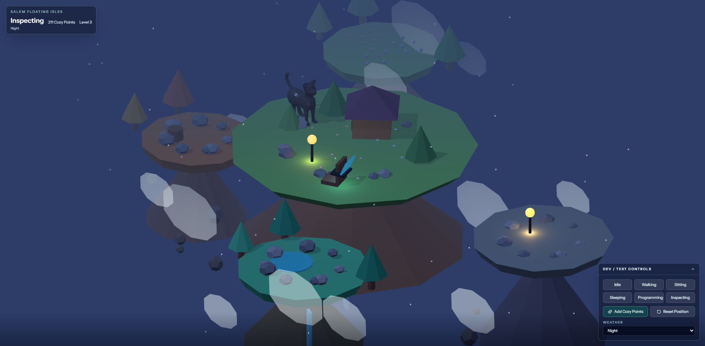

# Rechi OS

Portfolio pessoal de Caique Rechi em formato de sistema operacional: janelas, dock, terminal seguro, projetos como apps e area administrativa protegida.

## Salem Floating Isles v1

Registro da primeira versao visual do mini-game `/salem`.



## Stack

- Laravel 13, PHP 8.3+, React, TypeScript, Inertia, Tailwind CSS e Vite.
- MySQL, Redis, filas Redis, Mailpit, Laravel Sanctum e Laravel Telescope.
- PHPUnit, Vitest, React Testing Library, Pint, Larastan, ESLint e Prettier.

## Rodando localmente

1. Clone `crow-vault-canvas` ao lado deste repositorio (`../crow-vault-canvas`). O Composer instala o pacote por esse caminho e o `compose.yaml` monta a mesma pasta nos containers.
2. Copie `.env.example` para `.env` e troque `DB_ROOT_PASSWORD`.
3. Preencha `ADMIN_EMAIL` e `ADMIN_PASSWORD` se quiser criar o primeiro admin pelo seeder.
4. Rode `composer install` no host: a imagem do Sail e construida a partir de `vendor/laravel/sail`.
5. Suba os servicos e prepare a aplicacao:

```bash
docker compose up -d
docker compose exec laravel.test php artisan key:generate
docker compose exec laravel.test php artisan migrate --seed
docker compose exec laravel.test npm ci
docker compose exec laravel.test npm run dev
```

O projeto Compose se chama `rechi-os-cvc-local` e sobe `laravel.test`, `queue` (worker da fila), `mysql`, `redis` e `mailpit`. Todas as portas publicadas ficam presas a `127.0.0.1`:

| Servico | Endereco |
| --- | --- |
| Aplicacao | `http://localhost:8080` |
| Vite | `localhost:5173` |
| Mailpit | `http://localhost:8025` (SMTP em `10250`) |
| MySQL | `localhost:33060` |
| Redis | `localhost:63790` |

`node_modules` fica num volume do Docker, separado do host, entao instale e rode o npm sempre dentro de `laravel.test`. Uma variavel `COMPOSE_PROJECT_NAME` definida no shell tem precedencia sobre o `.env`; se ela existir, passe `-p rechi-os-cvc-local` aos comandos `docker compose`.

Para abrir `/vault`, siga tambem o setup local do `crow-vault-canvas/README.md`: `CVC_ENABLED=true`, `php artisan cvc:initialize` e permissao `write` na tela `vault` para o usuario. O Docker usa `CVC_STORAGE_ROOT=/var/lib/cvc` em um volume nomeado privado, inicializado com UID/GID do Sail e modo `0700`; isso evita que o bind mount do Windows transforme arquivos privados em caminhos ilegíveis para o servidor ou a fila.

No Windows sem Docker, use PHP 8.3, Composer, Node 24 e um MySQL/Redis locais, ajustando `DB_HOST` e `REDIS_HOST` para `127.0.0.1`.

## Admin

O registro publico foi desativado. Crie um admin com:

```bash
php artisan portfolio:create-admin email@dominio.com
```

O painel administrativo inclui `/dashboard/game-planner`, com busca completa de
itens de Terraria/Calamity e timelines algorítmicas para classes e subclasses.
Consulte `docs/game-data.md` para importar o catálogo, os ícones e reconstruir os
planners.

## Verificacoes

```bash
composer validate
vendor/bin/pint --test --parallel
vendor/bin/phpstan analyse
npm run lint:check
npm run types:check
php artisan test
npm run test:react
npm run build
```

## Variaveis principais

- `ADMIN_EMAIL`, `ADMIN_PASSWORD`: admin inicial opcional via seeder.
- `OPENAI_API_KEY`, `OPENAI_MODEL`: assistente Ask Rechi.
- `DB_*`, `REDIS_*`, `CACHE_STORE`, `QUEUE_CONNECTION`, `SESSION_DRIVER`: infraestrutura local.
